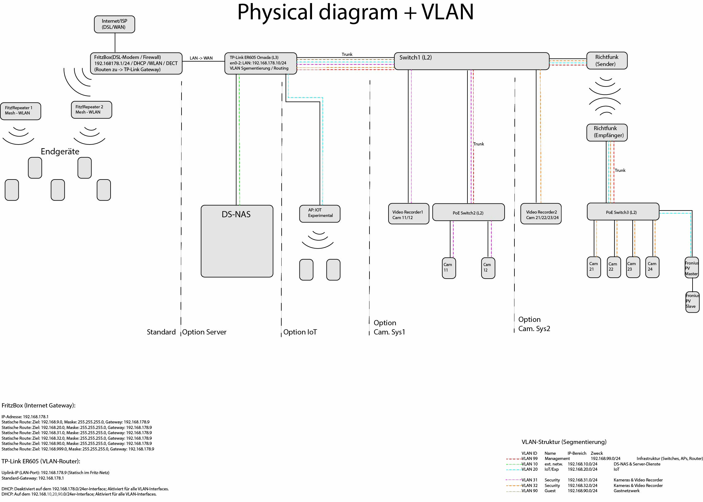

# Homelab Network Design – VLAN Segmentation behind a FritzBox

A segmented home network built around a FritzBox as the internet gateway and a TP-Link ER605 as the VLAN router. NAS, IoT devices, two camera systems and guests each live in their own network, while the rest of the household keeps using the FritzBox network exactly as before.



---

## Why I built this

Like most home networks, mine started as one flat network: laptops, phones, the NAS, cameras and every cheap smart device all in the same subnet. That works, but it means a single compromised IoT gadget or camera can see everything else.

I wanted to fix that without breaking anything for the people I live with. So the goals were:

- **Separate what doesn't need to talk to each other.** IoT, cameras and guests get their own isolated networks.
- **Keep the existing network untouched.** The FritzBox, its Wi-Fi mesh and DECT keep working as usual, and nobody has to reconfigure their devices.
- **Keep management separate.** Switches and other infrastructure are managed through a dedicated VLAN.
- **Make it expandable.** New zones (e.g. a second camera system at a remote site) can be added without redesigning everything.

---

## Architecture

```
Internet
   │
FritzBox (ISP gateway, Wi-Fi mesh, DHCP for the home network)
   │  192.168.178.0/24
   │
TP-Link ER605 (VLAN routing, firewall / ACLs)
   │  802.1Q trunk
   │
Switch 1 (core) ──┬── NAS, IoT access point
                  ├── PoE Switch 2 ── Camera system 1 + NVR 1
                  ├── NVR 2
                  └── Point-to-point wireless bridge ── PoE Switch 3 (remote site)
                                                         └── Camera system 2, IoT devices
```

- The **FritzBox** stays the internet gateway. It has static routes for all VLAN subnets pointing to the ER605, so devices in the home network can reach the NAS and other services.
- The **ER605** sits in the FritzBox network with a static address and routes between the VLANs. All inter-VLAN traffic passes through its ACLs.
- **Three managed switches** distribute the VLANs. A wireless bridge carries the trunk to a second building, so its devices end up in the same VLANs as if they were wired.

---

## Network zones

| VLAN | Zone | Subnet | Isolated | Purpose |
|------|------|--------|:--------:|---------|
| – | Home network (FritzBox) | 192.168.178.0/24 | – | PCs, phones, TVs, Wi-Fi mesh |
| 10 | Extended network | 192.168.10.0/24 | no | NAS and trusted services |
| 20 | IoT | 192.168.20.0/24 | yes | Smart home and test devices |
| 31 | Camera system 1 | 192.168.31.0/24 | yes | NVR 1 and its cameras |
| 32 | Camera system 2 | 192.168.32.0/24 | yes | NVR 2 and its cameras (remote site) |
| 90 | Guest | 192.168.90.0/24 | yes | Guest Wi-Fi |
| 99 | Management | 192.168.99.0/24 | no | Switches, access points, infrastructure |

Full addressing, switch port assignments and device IPs: **[ip-plan.md](ip-plan.md)**

---

## Security concept

- **Isolated zones** (IoT, cameras, guest) can reach the internet, DNS and NTP, but cannot open connections into other internal networks.
- **Each camera system has its own VLAN and NVR**, so a compromised camera can't reach the rest of the network, and recordings stay local.
- **Access into zones is one-way.** The trusted networks can reach the cameras and the NAS; the isolated zones can't reach back.
- **Infrastructure is managed in its own VLAN** instead of the regular home network.
- **Remote access only via the FritzBox VPN** – no internal services are exposed directly to the internet.

All ACL rules, IP groups and the resulting access matrix: **[Firewall.md](Firewall.md)**

---

## Hardware

| Role | Device |
|------|--------|
| Internet gateway | AVM FritzBox + 2× Fritz!Repeater (mesh) |
| VLAN router / firewall | TP-Link ER605 (Omada) |
| Core switch | Managed L2 switch (Switch 1) |
| Camera switches | 2× managed PoE switch (Switch 2 & 3) |
| Storage | Synology NAS |
| Wireless | IoT access point, point-to-point wireless bridge (sender/receiver) |
| Surveillance | 2× network video recorder (NVR) with IP cameras |

---

## Lessons learned

- **Static routes on the FritzBox are essential.** Without them, the FritzBox doesn't know where the VLAN subnets are, and traffic from the home network to the NAS simply goes nowhere.
- **Planning the IP scheme first saves a lot of pain.** Using the VLAN ID as the third octet (VLAN 31 → 192.168.31.0/24) makes every address self-explanatory when troubleshooting.
- **Trunk ports have to match on both ends.** A VLAN missing on one side of a trunk – including across the wireless bridge – fails silently and is easy to overlook.
- **Keeping the FritzBox network as it was** made the whole project much easier to roll out. Nobody else in the house noticed a change, which is exactly the point.

---

## Next steps

- [ ] Restrict access to the management VLAN to a single admin device and only the required services (currently too permissive, see the note in [Firewall.md](Firewall.md))
- [ ] Add explicit deny rules for the isolated zones and verify the isolation with connectivity tests
- [ ] Central logging and basic monitoring of the network devices
- [ ] Evaluate removing the double NAT between FritzBox and ER605

---

## Repository contents

| File | Content |
|------|---------|
| [README.md](README.md) | This overview |
| [ip-plan.md](ip-plan.md) | Subnets, static routes, switch ports, device addresses |
| [Firewall.md](Firewall.md) | IP groups, ACL rules, security model |
| [physical-diagram.jpg](physical-diagram.jpg) | Physical layout and VLAN overview |

> All addresses are private (RFC 1918) and specific to this lab. No credentials, public IPs or device identifiers are included.
